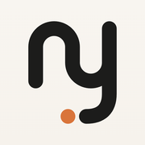

  

<h1 align="center">Not Yet</h1>

<b>Start. Keep going. Stop when it’s time.</b> 
A routine app for iPhone and Apple Watch, built with ADHD in mind.

  

---

This repository is the website of the app: **[not-yet.app](https://not-yet.app)**.

## The app

Not Yet is for the gap between knowing and doing: getting going in the morning, staying on a task, and putting the phone down at night.

- **Routines that don’t get old.** Every run plays a little differently: a wheel picks the next step, dice set the order, a boss fight saves the longest step for last.
- **Done from the Lock Screen.** Check off the current step without opening the app, on your iPhone or your Apple Watch.
- **A wake-up alarm one tap won’t stop.** It rings even on silent and goes quiet only after a short task, like three quick math problems.
- **Week and Nights.** See your next seven days at a glance, and plan bedtimes the way you set alarms.
- **Locks for focus and bedtime.** Keep the apps that pull you in closed while you work or sleep.
- **No streaks, no red numbers.** Runs count. Gaps don’t.

No account, no tracking in the app. Available in English, German, Spanish, French, Italian, Portuguese, Japanese and Korean.

## Contact

[info@not-yet.app](mailto:info@not-yet.app) · [Support](https://not-yet.app/support/) · [Privacy](https://not-yet.app/privacy/)
